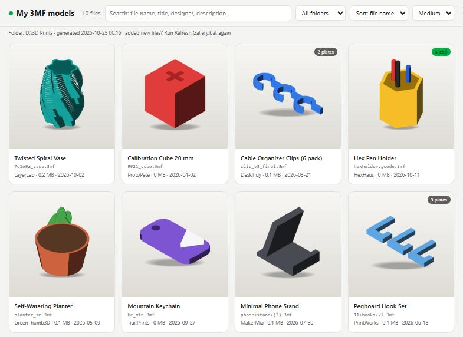
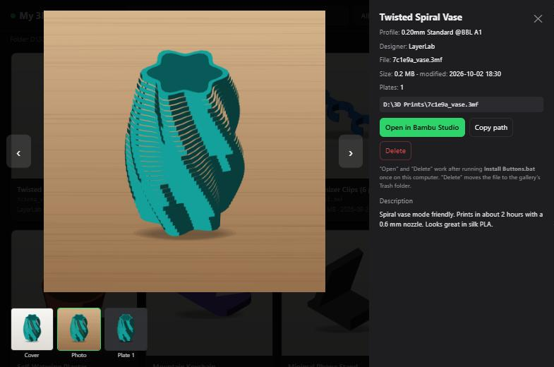

# 3MF Gallery

A browsable picture gallery of your `.3mf` print files, for Windows.

If you download a lot of models from [MakerWorld](https://makerworld.com) or Printables, your folder soon fills up with names like `13878.3mf` or `a8f3c2_model.3mf`, and you have to open each one in Bambu Studio to remember what it is. 3MF Gallery builds a single `gallery.html` page with a picture, the real model title, and the designer for every file. You can search, sort and filter it, and open any model in Bambu Studio with one click.





<sub>The screenshots show fictional sample models made for this README.</sub>

- **Nothing to install.** It runs on PowerShell, which comes with every copy of Windows 10 and 11.
- **Your files are only read, never changed.** A `.3mf` file is a ZIP archive. Bambu Studio and MakerWorld store the cover image, the photos of printed models, a preview of every plate, and the title, designer and description inside it. The gallery just reads them.
- **Works on network drives / NAS.** Refreshing is fast: pictures are only extracted from new or changed files.

## Features

- A tile for every `.3mf` file, showing the model's real title (not the file name), designer, size and date
- Badges for multi-plate projects (`4 plates`) and sliced files (`.gcode.3mf`)
- Search across title, file name, designer, description and subfolder; multiple words must all match
- Subfolder filter, sorting (name, title, newest, oldest, largest) and three tile sizes
- Details view with large pictures: cover, MakerWorld photos and every plate (← → keys), plus the description and print profile
- **Open in Bambu Studio** opens the original file directly, without downloading a copy
- **Delete** moves the file to the gallery's `Trash` folder after a Windows confirmation, so it can always be restored
- **Copy path** copies the file's full path
- Light and dark mode, following your Windows setting
- Also reads thumbnails from Orca Slicer and PrusaSlicer `.3mf` files

## Quick start

1. Download this repository (green **Code** button → **Download ZIP**) and extract it.
2. Put the extracted folder **inside** the folder that holds your `.3mf` files, for example:
   ```
   D:\3D Prints\
   ├── !3MF Gallery\          <- this repository
   │   ├── Refresh Gallery.bat
   │   ├── Install Buttons.bat
   │   └── program\
   ├── Toys\
   ├── Workshop\
   ├── 13878.3mf
   └── ...
   ```
   A name starting with `!` keeps the folder at the top of the list.
3. Double-click **`Refresh Gallery.bat`**. It scans the parent folder and all its subfolders, writes `gallery.html` and an `images` folder next to itself, and opens the gallery in your browser.
4. *(Optional, once per computer)* Double-click **`Install Buttons.bat`** to enable the **Open in Bambu Studio** and **Delete** buttons.

Added new models? Run `Refresh Gallery.bat` again.

## Gallery for any folder

`program\Build-Gallery.bat` works with any folder. Double-click it for a folder picker (it remembers the last folder), or drag a folder onto it. The gallery is written to `<folder>\_3mf_gallery\gallery.html`.

From PowerShell:

```powershell
powershell -ExecutionPolicy Bypass -File program\Build-Gallery.ps1 -Folder "D:\3D Prints" [-Output "D:\Gallery"] [-NoOpen]
```

| Parameter | Meaning |
|---|---|
| `-Folder` | Folder with `.3mf` files, scanned with all subfolders. Without it, a folder picker opens. |
| `-Output` | Where to write the gallery. Default: `<Folder>\_3mf_gallery` |
| `-NoOpen` | Don't open the gallery when done. Useful for running from Windows Task Scheduler. |

## How the Open / Delete buttons work

A web page opened in a browser isn't allowed to start programs or delete files. `Install Buttons.bat` therefore registers a small helper as a `gallery3mf:` link handler. This is the same mechanism MakerWorld uses to open Bambu Studio from its website.

- **No administrator rights needed.** It writes only to your user's registry (`HKCU\Software\Classes\gallery3mf`) and copies `GalleryAction.ps1` to `%LOCALAPPDATA%\3MFGallery`.
- The first time you click a button, the browser asks whether to open "3MF Gallery". Tick **Always allow** and click **Open**.
- **Open** finds Bambu Studio through the Windows uninstall registry, `Program Files`, or the Start menu shortcut. If Bambu Studio isn't installed, the file opens in its default app.
- **Delete** always asks in a Windows dialog first. The file is then **moved** to `<gallery folder>\Trash`; to restore it, move it back. The regular Windows Recycle Bin doesn't work on network drives, which is why the gallery has its own Trash. Empty it by deleting the files in that folder.
- The helper only works on existing `.3mf` files, and deletion always needs your confirmation, so a website can't delete your files through it.
- After updating, run `Install Buttons.bat` again.
- To uninstall, run `"Install Buttons.bat" -Uninstall` from a command prompt.

## Files

```
Refresh Gallery.bat        rebuild the gallery for the parent folder
Install Buttons.bat        enable the Open / Delete buttons (once per computer)
program\
  Build-Gallery.ps1        the gallery builder
  Build-Gallery.bat        gallery for any folder (picker / drag & drop)
  gallery_template.html    gallery look and behaviour
  GalleryAction.ps1        Open / Delete helper
  Install-Buttons.ps1      installs the helper

Created when you run it:
gallery.html, images\      the gallery (safe to delete; rebuilt on next refresh)
Trash\                     files removed with the Delete button
deleted.js                 files deleted since the last refresh
```

## Troubleshooting

- **"No thumbnail in this file"**: the file contains no picture at all, which happens with files exported from CAD programs or saved without a preview. Open it once in Bambu Studio and save it (Ctrl+S), then refresh the gallery.
- **"Could not read the file"**: the file is damaged or isn't a real `.3mf` archive. The details view and the refresh window show the error.
- **Only `.3mf` files are listed.** `.stl`, `.step` and `.zip` files contain no pictures.
- **The buttons do nothing**: run `Install Buttons.bat` on this computer. If your browser blocked the link earlier, check its site settings.

## Requirements

Windows 10 or 11 with Windows PowerShell 5.1, which is built in. Any modern browser works. Bambu Studio is only needed for the Open button.

## License

[MIT](LICENSE). Pictures shown in your gallery come from your own files and belong to their original designers.
